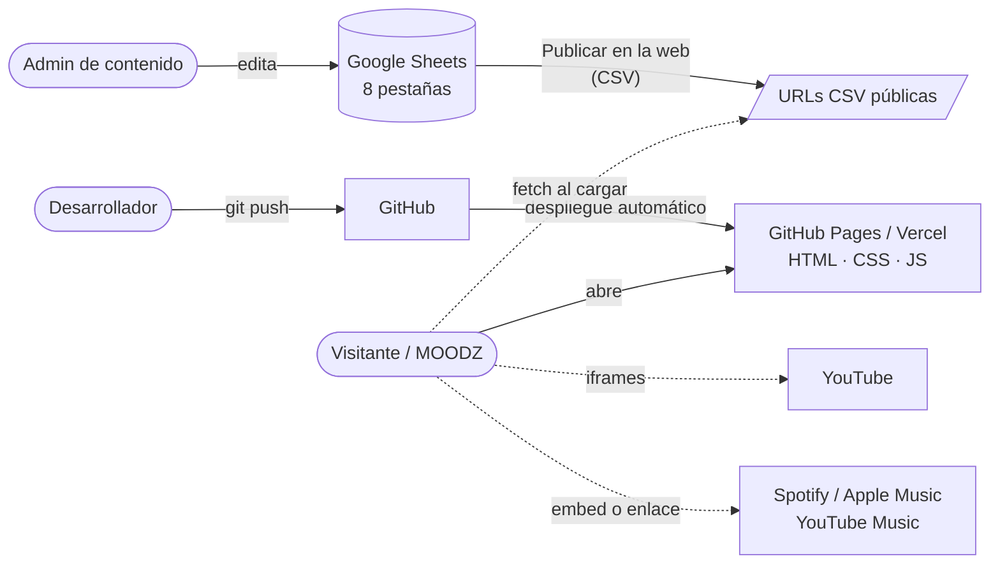

# WOODZ Archive y MOODZFLIX — Plan del proyecto

> Versión 0.1 · 2026-11-03 · Estado: **borrador para revisar con Ange**
>
> Documentos relacionados:
> [02-REQUERIMIENTOS](02-REQUERIMIENTOS.md) · [03-HISTORIAS-DE-USUARIO](03-HISTORIAS-DE-USUARIO.md) · [04-CASOS-DE-USO](04-CASOS-DE-USO.md) · [00-especificacion-original](00-especificacion-original.md)
>
> **Sin código todavía.** Esta etapa es solo documentación y planeación.

---

## 1. Qué vamos a construir

Un sitio fan de **WOODZ** (Cho Seungyoun) formado por **dos páginas conectadas**:

| Página | Qué es |
|---|---|
| **WOODZ Archive** (`index.html`) | La página principal. Portada en blanco y negro con video, un **timeline** de su carrera y un **tocadiscos** (Music Vault) con toda su discografía. |
| **MOODZFLIX** (`moodzflix.html`) | Una plataforma de videos con estética tipo **Apple TV**: banner destacado, filas por categoría y reproductor emergente. |

Es el mismo tipo de proyecto que **SVTFLIX**, y la idea es **reutilizar lo que ya funciona allí**: contenido editable desde Google Sheets, sin servidor, sin coste, con la misma forma de leer datos y el mismo reproductor de YouTube.

> El PDF llama a la plataforma **WOODZFLIX**. Ange pidió después que diga **MOODZFLIX**, porque así se llaman las fans. Este plan usa MOODZFLIX hasta que se confirme (decisión D1).

### Qué cambia respecto a SVTFLIX

| | SVTFLIX | WOODZ Archive |
|---|---|---|
| Páginas | Una (inicio con filas) | Dos: el Archivo y MOODZFLIX |
| Artista | Grupo de 13 (fichas de integrantes) | Solista (timeline de su carrera) |
| Pieza estrella | Top 13 con números | Tocadiscos interactivo |
| Estilo de la plataforma | Tipo Netflix (rojo y negro) | Tipo Apple TV (más limpio, sin bordes marcados) |

## 2. Restricciones (no negociables)

| # | Restricción | Consecuencia |
|---|---|---|
| R1 | **Coste cero.** No hay monetización. | Nada de servidores ni bases de datos de pago. |
| R2 | **Web estática, sin backend propio.** | Solo HTML, CSS y JS. Los datos se leen de Google Sheets publicado como CSV. |
| R3 | **Sin registros ni cuentas.** | Sin login, sin perfiles, sin comentarios. |
| R4 | **Sitio fan, no oficial.** | Aviso visible, créditos y nada de marcas ajenas (ni logo ni tipografía de Netflix o Apple TV). |
| R5 | **Nada de datos inventados.** | Fechas, agencias, canciones y videos solo de fuentes verificadas. Si un dato falta, se deja vacío. |
| R6 | **No subimos música ni videos ajenos.** | Videos incrustados desde YouTube y música mediante plataformas oficiales (Spotify, Apple Music, YouTube Music). |

## 3. Alcance

### Dentro (v1.0)

**WOODZ Archive**
- **Portada (hero)**: clip corto en blanco y negro en bucle, título *WELCOME TO WOODZ ARCHIVE* y dos botones: *Conoce a WOODZ* (baja al timeline) y *Ver MOODZFLIX* (abre la plataforma).
- **Timeline horizontal**: una tarjeta por etapa, con año y nombre. Al tocarla se **despliega** la ficha: texto, foto y enlaces.
- **Music Vault**: lista de álbumes, mini álbumes y singles. Al elegir uno, el vinilo **gira** con la portada y aparecen las canciones y los enlaces para escucharlo.
- **Redes y plataformas** de WOODZ.
- **Botón "Volver al inicio"** al final, créditos y aviso de sitio fan.

**MOODZFLIX**
- Cabecera con el logo MOODZFLIX y enlace de vuelta al Archivo.
- **Banner destacado**: el último lanzamiento con video silenciado en bucle y botón *Reproducir*.
- **Filas por categoría**: Music Videos y Performances, Programas de Variedades, YOON-LOGS, Conciertos y Live Stages. Las categorías salen de la hoja, no del código.
- **Reproductor emergente** (YouTube) con botón *Ver en YouTube*.

**Ambas**: adaptadas a móvil, con imágenes de reserva y estados de carga.

### Fuera (por ahora)
- Cuentas, "Mi lista" sincronizada, comentarios.
- Subir o alojar videos o canciones propias.
- Panel de administración propio (el panel **es** Google Sheets).
- Formulario de sugerencias (en SVTFLIX sí está; aquí no lo pidieron).
- Varios idiomas.

### Opcional si da tiempo (v1.1)
- Buscador de videos en MOODZFLIX.
- Vista previa del video al pasar el ratón (ya existe en SVTFLIX).
- Enlace directo a un disco o una etapa (`#/disco/oo-li`).
- Filtro de la discografía por tipo (álbum, mini, single).

## 4. Arquitectura



**Cómo funciona, en simple:**
1. La persona abre la web y recibe archivos estáticos (sin servidor propio).
2. El navegador pide las pestañas de la hoja de Google como CSV.
3. El JavaScript convierte esas filas en el timeline, los discos y las filas de videos. Si una pestaña falla, el resto sigue funcionando.
4. Los videos se ven con el reproductor de YouTube. La música se escucha con el reproductor incrustado de Spotify o con enlaces a cada plataforma (decisión D4).

### Stack

Mismo stack que SVTFLIX, para reutilizar código y experiencia.

| Pieza | Elección | Motivo |
|---|---|---|
| Estructura | HTML5 semántico, dos páginas | Lo pide el PDF. |
| Estilos | Tailwind CSS v4 (CLI) | Igual que SVTFLIX. Compilado, no el CDN. |
| Lógica | JavaScript vanilla (módulos ES) | Sin framework. |
| CSV | PapaParse (versión fija) | Igual que SVTFLIX. |
| Contenido | Google Sheets → *Publicar en la web* → CSV | Editable por personas no técnicas. Sustituye al `data.js` del PDF (decisión D3). |
| Video | YouTube IFrame API sobre `youtube-nocookie.com` | Detecta videos que no se pueden incrustar. |
| Música | Embed de Spotify y enlaces a plataformas | No se aloja audio propio (R6). |
| Carruseles y timeline | Desplazamiento nativo con *scroll-snap* | Swiper.js solo si el nativo no basta: es una dependencia más. |
| Código | Git + GitHub, Gitflow | Igual que SVTFLIX. |
| Hosting | GitHub Pages para vistas previas, Vercel para la versión final | Igual que SVTFLIX. |

### Qué se reutiliza de SVTFLIX

| Módulo de SVTFLIX | Uso en WOODZ |
|---|---|
| `datos.js` (leer CSV, normalizar, caché) | Igual, con otras pestañas. |
| `youtube.js` (IDs, miniaturas, URLs) | Igual. |
| `seguro.js` (sin `innerHTML`, validar URLs) | Igual. |
| `ui/reproductor.js` | Base del reproductor de MOODZFLIX. |
| `ui/catalogo.js` (filas) | Base de las filas de MOODZFLIX, con otro estilo. |
| `vercel.json` (cabeceras de seguridad) | Igual, añadiendo Spotify a la lista de iframes permitidos. |

### Estructura de carpetas propuesta

```
WOODZ-Archive/
├── src/
│   └── styles.css              # entrada de Tailwind: colores y tipografías
├── web/                        # lo que se publica
│   ├── index.html              # WOODZ Archive
│   ├── moodzflix.html          # MOODZFLIX
│   ├── css/styles.css          # generado (no se sube a git)
│   ├── img/                    # logo, portadas, fotos del timeline, placeholder
│   ├── video/                  # clip B&N de la portada (corto y comprimido)
│   └── js/
│       ├── config.js  datos.js  youtube.js  seguro.js     # comunes
│       ├── archivo/   hero.js  timeline.js  vinilo.js  redes.js
│       └── moodzflix/ destacado.js  filas.js  reproductor.js
├── vercel.json
├── package.json
└── docs/
```

> El PDF propone `css/main.css`, `css/woodzflix.css` y `js/data.js`. Se mantiene la idea (dos páginas y datos separados del código), pero los datos pasan a la hoja y el código se divide en módulos para mantenerlo.

## 5. Dirección de diseño

Guía para la fase de diseño. Se respetan las reglas anti AI-slop del equipo.

| Página | Dirección | Referencias |
|---|---|---|
| Archivo, portada | Dos filas de clips en blanco y negro que se deslizan, título en medio (Cinzel) y dos botones. Un clip a la vez recupera el color. | TikTok de Ange |
| Archivo, timeline | Acordeón: un panel abierto con la ficha y los demás como pestañas estrechas con el nombre en vertical. En móvil, uno debajo del otro. | Segundo pin de Pinterest |
| Archivo, Music Vault | Lista a la izquierda, vinilo al centro, portada y datos a la derecha. En móvil, uno debajo del otro. El vinilo gira solo con un disco elegido. | Reproductor de vinilo rojo y negro, ilustración 3 |
| MOODZFLIX | Tipo Apple TV: imagen grande a sangre, tarjetas con esquinas suaves, poco texto y mucho aire. Que no parezca una copia de SVTFLIX. | Captura de *Silo* en Apple TV+ |

**Reglas que afectan a este proyecto:**
- **Un solo color de acento por página.** El PDF usa dorado y rojo a la vez. Propuesta: el Archivo en blanco y negro con un acento, MOODZFLIX con el suyo (decisión D8).
- **Sin números gigantes** en el timeline: el año va en tamaño normal dentro de la tarjeta.
- **Nada inclinado sin motivo.** El vinilo gira porque es su función.
- Los botones dicen qué pasa: *Conoce a WOODZ*, *Ver MOODZFLIX*, *Reproducir*, *Volver al inicio*.
- Antes de dar algo por terminado: verlo en 1366×768 y en tamaño celular.

## 6. Fases y entregables

Cada fase se cierra con algo que Ange pueda revisar.

| Fase | Objetivo | Entregables | HU incluidas | Hecho cuando… |
|---|---|---|---|---|
| **0. Decisiones** | Cerrar las preguntas de la sección 8 | Este plan con D1–D10 respondidas | — | Ange confirma nombre, estilo y alcance de la discografía |
| **1. Contenido** | Reunir y verificar datos | Hoja con las 8 pestañas llena y con fuentes | HU-18 a HU-21 | Cada fecha, canción y video tiene fuente y está revisado |
| **2. Diseño** | Bocetos de las pantallas clave | Portada, timeline, vinilo y MOODZFLIX en móvil y escritorio | — | Ange aprueba los bocetos |
| **3. Entorno** | Repo y despliegue | Repo, Tailwind compilando, vista previa en GitHub Pages | HU-27 | Un push a `develop` publica una vista previa |
| **4. Datos** | Leer la hoja | Módulos comunes adaptados desde SVTFLIX | HU-24 | La consola muestra las 8 pestañas normalizadas |
| **5. Archivo** | Página principal | Portada, timeline, Music Vault, redes, pie | HU-01 a HU-12 | Funciona con ratón, táctil y teclado |
| **6. MOODZFLIX** | Plataforma de videos | Banner, filas, reproductor | HU-13 a HU-17 | Un video que no se puede incrustar ofrece *Ver en YouTube* |
| **7. QA y lanzamiento** | Calidad y salida | Lighthouse, pruebas en móvil, metadatos para compartir, Vercel | HU-22 a HU-26 | Se cumplen los RNF de [02-REQUERIMIENTOS](02-REQUERIMIENTOS.md) y Ange da el visto bueno |

**El código empieza en la fase 3.** Las fases 0, 1 y 2 son de documentación, contenido y diseño.

### Definición de "terminado" para cualquier HU
- Cumple sus criterios de aceptación.
- Funciona en Chrome y Firefox de escritorio y en Chrome Android / Safari iOS.
- No muestra errores en consola con la hoja correcta.
- Se puede usar con teclado.
- Tiene vista previa publicada y revisada por otra persona.

## 7. Riesgos

| Riesgo | Prob. | Impacto | Mitigación |
|---|---|---|---|
| Datos de la carrera o la discografía mal puestos (fechas, agencias, canciones). | Alta | Alto | Cada fila de la hoja lleva una columna `Fuente`. Nada se publica sin fuente (R5). |
| YouTube muestra anuncios dentro del reproductor. El PDF pide "sin publicidad externa". | Alta | Bajo | No se puede evitar con un video incrustado. Se dice tal cual en el plan y no se promete en la web. |
| Videos con la incrustación desactivada o borrados. | Media | Medio | Igual que SVTFLIX: la IFrame API detecta el error y muestra *Ver en YouTube*. |
| Clips de la portada pesados o con problemas de derechos. | Media | Medio | Un solo clip corto (10–20 s), comprimido, sin audio, con imagen póster. Ange decide el fragmento (D7). |
| El embed de Spotify solo da 30 s a quien no tiene sesión iniciada. | Alta | Bajo | Además del embed, enlaces a Spotify, Apple Music y YouTube Music. |
| El autoplay del video se bloquea en móvil. | Alta | Bajo | Imagen póster de fondo. El video solo aparece si de verdad arranca. |
| El vinilo girando consume batería o marea. | Baja | Bajo | Solo gira con un disco elegido y se detiene con *reducir movimiento*. |
| Portadas enlazadas desde otras webs que bloquean el uso externo. | Alta | Medio | Las portadas se guardan en el repo (`web/img`). |
| Texto malicioso en la hoja (XSS). | Baja | Alto | Igual que SVTFLIX: nada de `innerHTML` con datos de la hoja, solo URLs `https:` y cabecera CSP. |
| Reclamo por marca o derechos. | Baja | Alto | Aviso de sitio fan, créditos y sin logos ni tipografías de Netflix o Apple. |

## 8. Decisiones

### Tomadas
- **D0.** Mismo enfoque que SVTFLIX: web estática, sin backend, coste cero, contenido en Google Sheets.
- **D0.1.** Dos páginas separadas, como pide el PDF: `index.html` (Archivo) y `moodzflix.html`.
- **D0.2.** No se aloja música ni videos ajenos. Todo se incrusta o se enlaza.
- **D1 y D2.** 2026-11-03: se llama **MOODZFLIX** y su estilo es tipo **Apple TV** (referencias de Ange).
- **D3.** 2026-11-04: la web lee **en vivo** la hoja de Google de Ange publicada como CSV (enlace de solo lectura, en `web/js/config.js`). Los cambios aparecen en unos 5 minutos sin subir nada. Si Google falla, se usa la última copia del navegador o la de `contenido/` (`npm run hoja`, con el ID de edición en `.hoja`, fuera del repo).
- **D6.** 2026-11-03: el timeline sigue el **segundo pin** de Pinterest: acordeón de paneles, uno abierto y el resto como pestañas con el nombre en vertical.
- **D-portada.** 2026-11-03: la portada sigue el **TikTok** de Ange: dos filas de clips en blanco y negro que se deslizan, título en medio con letra serif espaciada (Cinzel) y un clip que recupera el color cada pocos segundos.

### Pendientes (necesitan respuesta de Ange)
| ID | Pregunta | Recomendación |
|---|---|---|
| **D4** | ¿Cómo se "escucha" un disco en el tocadiscos? | **Embed de Spotify del álbum + enlaces a otras plataformas.** No se puede alojar el audio (R6). |
| **D5** | ¿Qué entra en la discografía? | **Lanzamientos como WOODZ**: álbumes, mini álbumes y singles digitales. Lo de UNIQ, Luizy y X1 va en el timeline, no en el vinilo. Colaboraciones y OST: decidir si entran como v1.1. |
| **D7** | ¿Qué clip va en la portada y quién lo prepara? | Un solo clip de 10–20 s elegido por Ange, convertido a B&N y comprimido por el equipo. |
| **D8** | ¿Qué colores de acento? El PDF usa dorado y rojo. | Archivo: blanco y negro con **dorado** como único acento. MOODZFLIX: un acento propio, a definir en diseño. |
| **D9** | ¿Quién edita la hoja? | Solo el equipo de Ange, con la fila de encabezados protegida. |
| **D10** | ¿Dominio? | `woodz-archive.vercel.app` (gratis). Un dominio propio solo si alguien lo paga. |

## 9. Equipo y roles

| Rol | Quién | Responsabilidad |
|---|---|---|
| Producto / contenido | Ange | Decidir qué se muestra, aprobar diseños, mantener la hoja |
| Diseño | Por definir | Bocetos y revisión de pantallas |
| Desarrollo | Nakusu (+ Claude) | Código, despliegue, QA |
