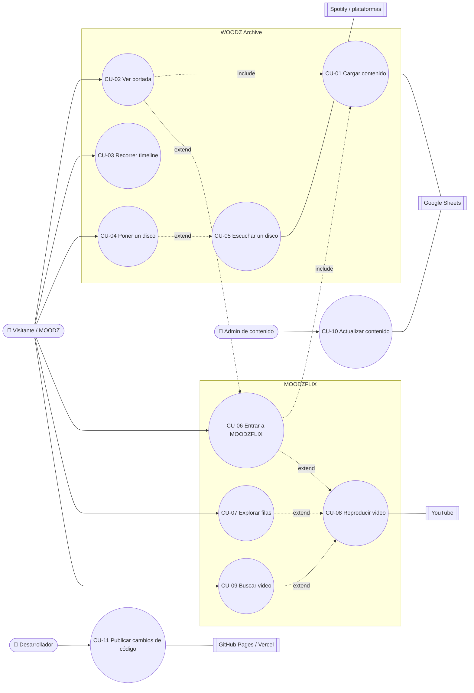

# WOODZ Archive y MOODZFLIX — Casos de uso

> Versión 0.1 · 2026-11-03 · Ver también [02-REQUERIMIENTOS](02-REQUERIMIENTOS.md) · [03-HISTORIAS-DE-USUARIO](03-HISTORIAS-DE-USUARIO.md)

## Diagrama general

*include* = siempre ocurre como parte del caso. *extend* = ocurre solo si el usuario lo elige.

---

## CU-01 · Cargar contenido
| Campo | Detalle |
|---|---|
| **Actor principal** | Visitante (indirecto), sistema Google Sheets |
| **Objetivo** | Tener en memoria las pestañas que necesita la página, ya normalizadas. |
| **Precondiciones** | `config.js` tiene las URLs CSV publicadas. |
| **Disparador** | Se abre `index.html` o `moodzflix.html`. |
| **RF / HU** | RF-01–06, RF-34 · HU-24 |

**Flujo principal**
1. El sistema pinta la estructura fija y los esqueletos.
2. El sistema pide en paralelo las pestañas de esa página (Archivo: `Portada`, `Etapas`, `Lanzamientos`, `Canciones`, `Redes`, `Creditos`. MOODZFLIX: `Destacado`, `Videos`, `Creditos`).
3. Cada CSV se convierte en filas, se normalizan los encabezados y se quitan las filas vacías o inactivas.
4. El sistema une `Canciones` con su `Lanzamiento` (solo en el Archivo).
5. El sistema guarda una copia de cada pestaña válida en el navegador.
6. El sistema entrega los datos a cada sección y quita los esqueletos.

**Flujos alternativos**
- **3a. Falta una columna obligatoria:** la sección afectada dice "Contenido no disponible ahora" y la consola indica pestaña y columna. El resto sigue.
- **4a. Una canción apunta a un lanzamiento que no existe:** se ignora y se avisa en consola.

**Excepciones**
- **2a. Una pestaña falla:** se usa su copia guardada. Si no hay, aplica 3a.
- **2b. Fallan todas y no hay copia:** mensaje "No pudimos cargar el contenido" con botón *Reintentar*.

**Postcondición:** cada sección tiene datos válidos o un mensaje controlado. Nunca una página en blanco.

---

## CU-02 · Ver la portada del Archivo
| Campo | Detalle |
|---|---|
| **Actor principal** | Visitante |
| **Precondiciones** | CU-01 cargó `Portada`. |
| **RF / HU** | RF-07–11, RF-23 · HU-01–03, HU-12 |

**Flujo principal**
1. El sistema muestra el póster en B&N, el título y los dos botones.
2. Cuando el póster ya se ve, el sistema carga el clip en B&N (silenciado, en bucle, sin controles) y hace un fundido del póster al video.
3. El visitante pulsa **Conoce a WOODZ** → la página baja al timeline (**CU-03**).
4. Al final de la página, el visitante pulsa **Volver al inicio** → la página sube a la portada.

**Flujos alternativos**
- **2a. *Reducir movimiento* activado o el clip no arranca en 5 s:** se queda el póster, sin mostrar error.
- **3a. El visitante pulsa *Ver MOODZFLIX*:** se abre `moodzflix.html` → **extiende a CU-06**.

---

## CU-03 · Recorrer el timeline
| Campo | Detalle |
|---|---|
| **Actor principal** | Visitante |
| **Precondiciones** | CU-01 cargó `Etapas`. |
| **RF / HU** | RF-12–15 · HU-04–06 |

**Flujo principal**
1. El sistema crea una tarjeta por etapa, en orden, con año y nombre.
2. El visitante recorre el timeline (arrastre, rueda, flechas o teclado). Cada movimiento se ajusta a una tarjeta.
3. El visitante pulsa una tarjeta.
4. El sistema despliega la ficha: foto, texto y enlaces. Si había otra abierta, la cierra.
5. El visitante pulsa un enlace → se abre en pestaña nueva.

**Flujos alternativos**
- **1a. Una etapa no tiene `Fuente`:** solo se muestra en la vista previa (RN-08).
- **4a. Faltan foto o enlaces:** la ficha se muestra sin ellos, sin huecos.
- **4b. El visitante pulsa la misma tarjeta otra vez o `Esc`:** la ficha se cierra.

---

## CU-04 · Poner un disco en el tocadiscos
| Campo | Detalle |
|---|---|
| **Actor principal** | Visitante |
| **Precondiciones** | CU-01 cargó `Lanzamientos` y `Canciones`. |
| **RF / HU** | RF-16–22 · HU-07–09, HU-11 |

**Flujo principal**
1. El sistema muestra la lista de lanzamientos (del más nuevo al más antiguo) y el vinilo quieto con el texto "Elige un disco".
2. El visitante elige un lanzamiento.
3. El sistema pone la portada en el centro del vinilo y lo hace girar.
4. El sistema muestra portada grande, título, tipo, fecha y canciones, con la principal marcada.
5. Si hay enlaces de música, aparece el botón **Escuchar** → **extiende a CU-05**.

**Flujos alternativos**
- **2a. El visitante filtra por tipo:** la lista se reduce. Si el disco elegido queda oculto, se mantiene en el vinilo.
- **3a. *Reducir movimiento*:** el vinilo no gira, solo cambia la portada.
- **3b. El visitante elige otro disco:** la portada cambia con un fundido corto y el vinilo sigue girando.
- **3c. La sección sale de la pantalla:** el vinilo se detiene y vuelve a girar al regresar.
- **4a. Sin canciones cargadas:** "Lista de canciones pendiente".
- **4b. Una canción tiene `URL_Video`:** al pulsarla se abre el reproductor (como CU-08).

---

## CU-05 · Escuchar un disco
| Campo | Detalle |
|---|---|
| **Actor principal** | Visitante |
| **Sistema externo** | Spotify, Apple Music, YouTube Music |
| **Precondiciones** | CU-04 con un disco elegido que tiene al menos un enlace de música. |
| **RF / HU** | RF-19 · HU-10 |

**Flujo principal**
1. El visitante pulsa **Escuchar**.
2. El sistema carga el reproductor incrustado de Spotify de ese disco, debajo de las canciones.
3. El visitante escucha desde el reproductor de Spotify.

**Flujos alternativos**
- **2a. No hay `URL_Spotify`:** solo se muestran los botones a Apple Music y YouTube Music, que abren en pestaña nueva.
- **3a. El visitante no tiene sesión en Spotify:** Spotify solo reproduce 30 s. Los botones a otras plataformas siguen visibles.

---

## CU-06 · Entrar a MOODZFLIX
| Campo | Detalle |
|---|---|
| **Actor principal** | Visitante |
| **Precondiciones** | CU-01 cargó `Destacado` y `Videos`. |
| **RF / HU** | RF-24, RF-25 · HU-13, HU-16 |

**Flujo principal**
1. El sistema muestra la cabecera con el logo MOODZFLIX y el enlace *WOODZ Archive*.
2. El sistema muestra el banner destacado: póster, título, descripción y botones.
3. Cuando el póster ya se ve, carga el video de fondo silenciado y hace un fundido.
4. El visitante pulsa **Reproducir** → **extiende a CU-08**.

**Flujos alternativos**
- **3a. *Reducir movimiento* o el video no arranca:** se queda el póster.
- **4a. El visitante pulsa *WOODZ Archive*:** vuelve a `index.html`.

---

## CU-07 · Explorar las filas de videos
| Campo | Detalle |
|---|---|
| **Actor principal** | Visitante |
| **Precondiciones** | CU-01 cargó `Videos`. |
| **RF / HU** | RF-26, RF-27, RF-30, RF-31 · HU-14 |

**Flujo principal**
1. El sistema agrupa los videos por `Categoria`, en el orden de `Orden_Categoria`.
2. El sistema crea una fila por categoría con sus tarjetas (miniatura, título, duración).
3. El visitante recorre una fila (flechas, arrastre o teclado).
4. El visitante pulsa una tarjeta → **extiende a CU-08**.

**Flujos alternativos**
- **2a. Sin `URL_Miniatura`:** se usa la miniatura de YouTube. Si es una lista sin miniatura, la imagen de reserva.
- **2b. Una categoría no tiene videos válidos:** la fila no se muestra.

---

## CU-08 · Reproducir un video
| Campo | Detalle |
|---|---|
| **Actor principal** | Visitante |
| **Sistema externo** | YouTube |
| **Precondiciones** | Un video o lista con URL válida de YouTube. |
| **RF / HU** | RF-28, RF-29 · HU-15 |

**Flujo principal**
1. El sistema abre el reproductor encima de la página y lleva el foco dentro.
2. El sistema incrusta el video desde `youtube-nocookie.com` con su título y el botón *Ver en YouTube*.
3. El visitante ve el video.
4. El visitante cierra con X, `Esc` o clic fuera. El video se detiene y el foco vuelve a la tarjeta de origen.

**Flujos alternativos**
- **2a. Error 101/150 (no se puede incrustar) o 100 (no existe):** mensaje "Este video solo puede verse en YouTube" con el botón destacado.
- **2b. Es una lista:** se incrusta la lista completa.

---

## CU-09 · Buscar un video (v1.1)
| Campo | Detalle |
|---|---|
| **Actor principal** | Visitante |
| **RF / HU** | RF-32 · HU-17 |

**Flujo principal**
1. El visitante abre el buscador y escribe.
2. El sistema compara el texto con los títulos, sin tildes ni mayúsculas.
3. El sistema muestra las coincidencias en una cuadrícula.
4. El visitante pulsa un resultado → **extiende a CU-08**.

**Flujo alternativo**
- **3a. Sin coincidencias:** "No encontramos videos con ese nombre".

---

## CU-10 · Actualizar contenido
| Campo | Detalle |
|---|---|
| **Actor principal** | Admin de contenido |
| **Sistema externo** | Google Sheets |
| **Precondiciones** | Permiso de edición en la hoja y la guía de edición a mano. |
| **RF / HU** | RNF-08, RNF-13, RNF-15 · HU-18–21 |

**Flujo principal**
1. La admin abre la hoja y va a la pestaña que toca.
2. Añade o cambia una fila siguiendo la guía, con su `Fuente`.
3. Google publica el cambio en el CSV (puede tardar unos 5 min).
4. La próxima vez que alguien abra la web, el cambio aparece.

**Flujos alternativos**
- **2a. Añade un disco:** una fila en `Lanzamientos` y una fila por canción en `Canciones`, con el mismo `ID`.
- **2b. Añade un video de una categoría nueva:** aparece una fila nueva en MOODZFLIX.
- **2c. Deja una columna obligatoria vacía:** esa fila no aparece y la consola lo indica (CU-01, 3a).

---

## CU-11 · Publicar cambios de código
| Campo | Detalle |
|---|---|
| **Actor principal** | Desarrollador |
| **Sistema externo** | GitHub, GitHub Pages / Vercel |
| **RF / HU** | RNF-12 · HU-27 |

**Flujo principal**
1. El desarrollador trabaja en una rama `feature/*` y la une a `develop`.
2. El push a `develop` publica la vista previa en GitHub Pages.
3. Ange revisa la vista previa.
4. Con el visto bueno, se crea `release/*` → `main` y Vercel publica la versión final.

**Flujo alternativo**
- **3a. Ange pide cambios:** se vuelve al paso 1.
